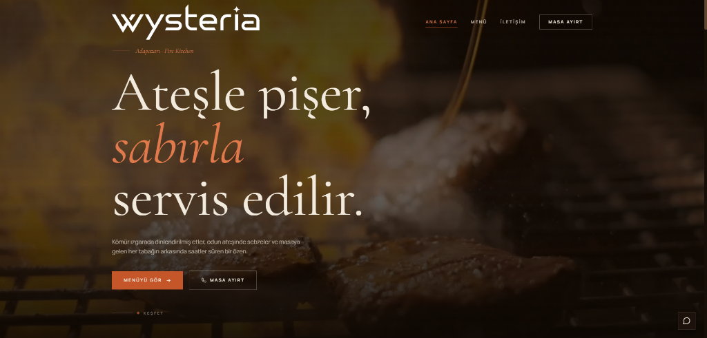
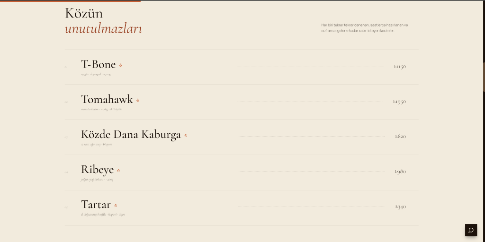
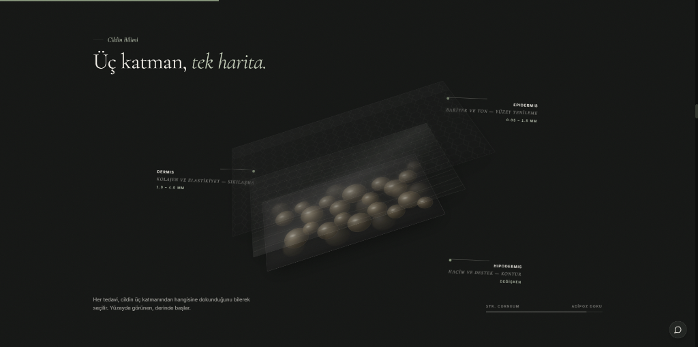

# Wysteria Works — RBS

Restoranlar ve ateş mutfağı konseptleri için hazırlanmış tek sayfalık bir dijital vitrin çalışması. Kömür, duman ve karanlık mekân hissini taşıyan koyu bir tema üzerine kurulu; menü ve rezervasyon akışı ön planda tutuluyor.

**Canlı önizleme:** https://wysteria-works-rbs.vercel.app/

## Konsept

Tasarım, restoranın ocakbaşı karakterini dijitale taşıyor: derin kahverengi zemin, sıcak ışıklı görseller ve serbest akan kaydırma koreografisi. Yazı dili kısa ve net; ziyaretçi birkaç kaydırmada menüye, atmosfere ve rezervasyona ulaşıyor. Türkçe ve İngilizce içerik hazır.

## Bölümler

- **Hero** — köz ve ateş görselli giriş sahnesi
- **Manifesto** — mutfağın yaklaşımını anlatan kısa metin
- **İmza tabaklar** — satır düzeninde liste, üzerine gelindiğinde görsel önizleme
- **Hikâye & zanaat** — pin'li kaydırmalı anlatım bölümleri
- **Galeri** — lightbox destekli mekân ve tabak görselleri
- **Ziyaret** — harita alanı, çalışma saatleri ve iletişim bilgileri
- **Rezervasyon** — menü sayfası ve WhatsApp üzerinden hızlı iletişim

## Teknik yapı

React 18 · TypeScript · Vite · Tailwind CSS · GSAP + ScrollTrigger · Lenis pürüzsüz kaydırma · React Router · TR/EN dil desteği

Kaydırma koreografisi `prefers-reduced-motion` tercihine saygılı; mobilde pin ve paralaks sahneleri sadeleştiriliyor.

## Not

Sitedeki menü içerikleri, fiyatlar ve görseller vitrin amaçlı temsilidir; restoranın kendi menüsü ve bilgileriyle güncellenmesi yeterlidir.
